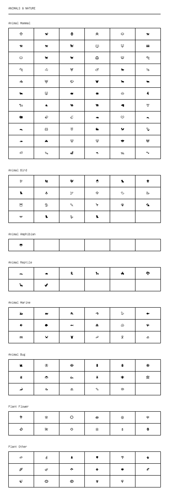

# Animals & Nature

[← Back to Index](../README.md)

### Animal Mammal

<table>
  <tr>
    <td align="center"><kbd>🐵</kbd></td>
    <td align="center"><kbd>🐒</kbd></td>
    <td align="center"><kbd>🦍</kbd></td>
    <td align="center"><kbd>🦧</kbd></td>
    <td align="center"><kbd>🐶</kbd></td>
    <td align="center"><kbd>🐕</kbd></td>
  </tr>
  <tr>
    <td align="center"><kbd>🦮</kbd></td>
    <td align="center"><kbd>🐕‍🦺</kbd></td>
    <td align="center"><kbd>🐩</kbd></td>
    <td align="center"><kbd>🐺</kbd></td>
    <td align="center"><kbd>🦊</kbd></td>
    <td align="center"><kbd>🦝</kbd></td>
  </tr>
  <tr>
    <td align="center"><kbd>🐱</kbd></td>
    <td align="center"><kbd>🐈</kbd></td>
    <td align="center"><kbd>🐈‍⬛</kbd></td>
    <td align="center"><kbd>🦁</kbd></td>
    <td align="center"><kbd>🐯</kbd></td>
    <td align="center"><kbd>🐅</kbd></td>
  </tr>
  <tr>
    <td align="center"><kbd>🐆</kbd></td>
    <td align="center"><kbd>🐴</kbd></td>
    <td align="center"><kbd>🫎</kbd></td>
    <td align="center"><kbd>🫏</kbd></td>
    <td align="center"><kbd>🐎</kbd></td>
    <td align="center"><kbd>🦄</kbd></td>
  </tr>
  <tr>
    <td align="center"><kbd>🦓</kbd></td>
    <td align="center"><kbd>🦌</kbd></td>
    <td align="center"><kbd>🦬</kbd></td>
    <td align="center"><kbd>🐮</kbd></td>
    <td align="center"><kbd>🐂</kbd></td>
    <td align="center"><kbd>🐃</kbd></td>
  </tr>
  <tr>
    <td align="center"><kbd>🐄</kbd></td>
    <td align="center"><kbd>🐷</kbd></td>
    <td align="center"><kbd>🐖</kbd></td>
    <td align="center"><kbd>🐗</kbd></td>
    <td align="center"><kbd>🐽</kbd></td>
    <td align="center"><kbd>🐏</kbd></td>
  </tr>
  <tr>
    <td align="center"><kbd>🐑</kbd></td>
    <td align="center"><kbd>🐐</kbd></td>
    <td align="center"><kbd>🐪</kbd></td>
    <td align="center"><kbd>🐫</kbd></td>
    <td align="center"><kbd>🦙</kbd></td>
    <td align="center"><kbd>🦒</kbd></td>
  </tr>
  <tr>
    <td align="center"><kbd>🐘</kbd></td>
    <td align="center"><kbd>🦣</kbd></td>
    <td align="center"><kbd>🦏</kbd></td>
    <td align="center"><kbd>🦛</kbd></td>
    <td align="center"><kbd>🐭</kbd></td>
    <td align="center"><kbd>🐁</kbd></td>
  </tr>
  <tr>
    <td align="center"><kbd>🐀</kbd></td>
    <td align="center"><kbd>🐹</kbd></td>
    <td align="center"><kbd>🐰</kbd></td>
    <td align="center"><kbd>🐇</kbd></td>
    <td align="center"><kbd>🐿️</kbd></td>
    <td align="center"><kbd>🦫</kbd></td>
  </tr>
  <tr>
    <td align="center"><kbd>🦔</kbd></td>
    <td align="center"><kbd>🦇</kbd></td>
    <td align="center"><kbd>🐻</kbd></td>
    <td align="center"><kbd>🐻‍❄️</kbd></td>
    <td align="center"><kbd>🐨</kbd></td>
    <td align="center"><kbd>🐼</kbd></td>
  </tr>
  <tr>
    <td align="center"><kbd>🦥</kbd></td>
    <td align="center"><kbd>🦦</kbd></td>
    <td align="center"><kbd>🦨</kbd></td>
    <td align="center"><kbd>🦘</kbd></td>
    <td align="center"><kbd>🦡</kbd></td>
    <td align="center"><kbd>🐾</kbd></td>
  </tr>
</table>

### Animal Bird

<table>
  <tr>
    <td align="center"><kbd>🦃</kbd></td>
    <td align="center"><kbd>🐔</kbd></td>
    <td align="center"><kbd>🐓</kbd></td>
    <td align="center"><kbd>🐣</kbd></td>
    <td align="center"><kbd>🐤</kbd></td>
    <td align="center"><kbd>🐥</kbd></td>
  </tr>
  <tr>
    <td align="center"><kbd>🐦</kbd></td>
    <td align="center"><kbd>🐧</kbd></td>
    <td align="center"><kbd>🕊️</kbd></td>
    <td align="center"><kbd>🦅</kbd></td>
    <td align="center"><kbd>🦆</kbd></td>
    <td align="center"><kbd>🦢</kbd></td>
  </tr>
  <tr>
    <td align="center"><kbd>🦉</kbd></td>
    <td align="center"><kbd>🦤</kbd></td>
    <td align="center"><kbd>🪶</kbd></td>
    <td align="center"><kbd>🦩</kbd></td>
    <td align="center"><kbd>🦚</kbd></td>
    <td align="center"><kbd>🦜</kbd></td>
  </tr>
  <tr>
    <td align="center"><kbd>🪽</kbd></td>
    <td align="center"><kbd>🐦‍⬛</kbd></td>
    <td align="center"><kbd>🪿</kbd></td>
    <td align="center"><kbd>🐦‍🔥</kbd></td>
    <td></td>
    <td></td>
  </tr>
</table>

### Animal Amphibian

<table>
  <tr>
    <td align="center"><kbd>🐸</kbd></td>
    <td></td>
    <td></td>
    <td></td>
    <td></td>
    <td></td>
  </tr>
</table>

### Animal Reptile

<table>
  <tr>
    <td align="center"><kbd>🐊</kbd></td>
    <td align="center"><kbd>🐢</kbd></td>
    <td align="center"><kbd>🦎</kbd></td>
    <td align="center"><kbd>🐍</kbd></td>
    <td align="center"><kbd>🐲</kbd></td>
    <td align="center"><kbd>🐉</kbd></td>
  </tr>
  <tr>
    <td align="center"><kbd>🦕</kbd></td>
    <td align="center"><kbd>🦖</kbd></td>
    <td></td>
    <td></td>
    <td></td>
    <td></td>
  </tr>
</table>

### Animal Marine

<table>
  <tr>
    <td align="center"><kbd>🐳</kbd></td>
    <td align="center"><kbd>🐋</kbd></td>
    <td align="center"><kbd>🐬</kbd></td>
    <td align="center"><kbd>🫍</kbd></td>
    <td align="center"><kbd>🦭</kbd></td>
    <td align="center"><kbd>🐟</kbd></td>
  </tr>
  <tr>
    <td align="center"><kbd>🐠</kbd></td>
    <td align="center"><kbd>🐡</kbd></td>
    <td align="center"><kbd>🦈</kbd></td>
    <td align="center"><kbd>🐙</kbd></td>
    <td align="center"><kbd>🐚</kbd></td>
    <td align="center"><kbd>🪸</kbd></td>
  </tr>
  <tr>
    <td align="center"><kbd>🪼</kbd></td>
    <td align="center"><kbd>🦀</kbd></td>
    <td align="center"><kbd>🦞</kbd></td>
    <td align="center"><kbd>🦐</kbd></td>
    <td align="center"><kbd>🦑</kbd></td>
    <td align="center"><kbd>🦪</kbd></td>
  </tr>
</table>

### Animal Bug

<table>
  <tr>
    <td align="center"><kbd>🐌</kbd></td>
    <td align="center"><kbd>🦋</kbd></td>
    <td align="center"><kbd>🫌</kbd></td>
    <td align="center"><kbd>🐛</kbd></td>
    <td align="center"><kbd>🐜</kbd></td>
    <td align="center"><kbd>🐝</kbd></td>
  </tr>
  <tr>
    <td align="center"><kbd>🪲</kbd></td>
    <td align="center"><kbd>🐞</kbd></td>
    <td align="center"><kbd>🦗</kbd></td>
    <td align="center"><kbd>🪳</kbd></td>
    <td align="center"><kbd>🕷️</kbd></td>
    <td align="center"><kbd>🕸️</kbd></td>
  </tr>
  <tr>
    <td align="center"><kbd>🦂</kbd></td>
    <td align="center"><kbd>🦟</kbd></td>
    <td align="center"><kbd>🪰</kbd></td>
    <td align="center"><kbd>🪱</kbd></td>
    <td align="center"><kbd>🦠</kbd></td>
    <td></td>
  </tr>
</table>

### Plant Flower

<table>
  <tr>
    <td align="center"><kbd>💐</kbd></td>
    <td align="center"><kbd>🌸</kbd></td>
    <td align="center"><kbd>💮</kbd></td>
    <td align="center"><kbd>🪷</kbd></td>
    <td align="center"><kbd>🏵️</kbd></td>
    <td align="center"><kbd>🌹</kbd></td>
  </tr>
  <tr>
    <td align="center"><kbd>🥀</kbd></td>
    <td align="center"><kbd>🌺</kbd></td>
    <td align="center"><kbd>🌻</kbd></td>
    <td align="center"><kbd>🌼</kbd></td>
    <td align="center"><kbd>🌷</kbd></td>
    <td align="center"><kbd>🪻</kbd></td>
  </tr>
</table>

### Plant Other

<table>
  <tr>
    <td align="center"><kbd>🌱</kbd></td>
    <td align="center"><kbd>🪴</kbd></td>
    <td align="center"><kbd>🌲</kbd></td>
    <td align="center"><kbd>🌳</kbd></td>
    <td align="center"><kbd>🌴</kbd></td>
    <td align="center"><kbd>🌵</kbd></td>
  </tr>
  <tr>
    <td align="center"><kbd>🌾</kbd></td>
    <td align="center"><kbd>🌿</kbd></td>
    <td align="center"><kbd>☘️</kbd></td>
    <td align="center"><kbd>🍀</kbd></td>
    <td align="center"><kbd>🍁</kbd></td>
    <td align="center"><kbd>🍂</kbd></td>
  </tr>
  <tr>
    <td align="center"><kbd>🍃</kbd></td>
    <td align="center"><kbd>🪹</kbd></td>
    <td align="center"><kbd>🪺</kbd></td>
    <td align="center"><kbd>🍄</kbd></td>
    <td align="center"><kbd>🪾</kbd></td>
    <td></td>
  </tr>
</table>

## Visual Fallback Reference
If your system lacks the required fonts to render these emojis properly, use the image below as a visual guide.

