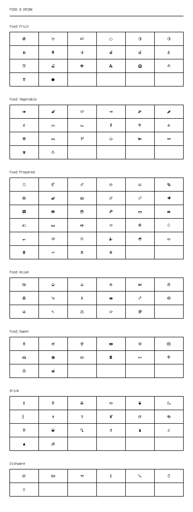

# Food & Drink

[← Back to Index](../README.md)

### Food Fruit

<table>
  <tr>
    <td align="center"><kbd>🍇</kbd></td>
    <td align="center"><kbd>🍈</kbd></td>
    <td align="center"><kbd>🍉</kbd></td>
    <td align="center"><kbd>🍊</kbd></td>
    <td align="center"><kbd>🍋</kbd></td>
    <td align="center"><kbd>🍋‍🟩</kbd></td>
  </tr>
  <tr>
    <td align="center"><kbd>🍌</kbd></td>
    <td align="center"><kbd>🍍</kbd></td>
    <td align="center"><kbd>🥭</kbd></td>
    <td align="center"><kbd>🍎</kbd></td>
    <td align="center"><kbd>🍏</kbd></td>
    <td align="center"><kbd>🍐</kbd></td>
  </tr>
  <tr>
    <td align="center"><kbd>🍑</kbd></td>
    <td align="center"><kbd>🍒</kbd></td>
    <td align="center"><kbd>🍓</kbd></td>
    <td align="center"><kbd>🫐</kbd></td>
    <td align="center"><kbd>🥝</kbd></td>
    <td align="center"><kbd>🍅</kbd></td>
  </tr>
  <tr>
    <td align="center"><kbd>🫒</kbd></td>
    <td align="center"><kbd>🥥</kbd></td>
    <td></td>
    <td></td>
    <td></td>
    <td></td>
  </tr>
</table>

### Food Vegetable

<table>
  <tr>
    <td align="center"><kbd>🥑</kbd></td>
    <td align="center"><kbd>🍆</kbd></td>
    <td align="center"><kbd>🥔</kbd></td>
    <td align="center"><kbd>🥕</kbd></td>
    <td align="center"><kbd>🌽</kbd></td>
    <td align="center"><kbd>🌶️</kbd></td>
  </tr>
  <tr>
    <td align="center"><kbd>🫑</kbd></td>
    <td align="center"><kbd>🥒</kbd></td>
    <td align="center"><kbd>🫝</kbd></td>
    <td align="center"><kbd>🥬</kbd></td>
    <td align="center"><kbd>🥦</kbd></td>
    <td align="center"><kbd>🧄</kbd></td>
  </tr>
  <tr>
    <td align="center"><kbd>🧅</kbd></td>
    <td align="center"><kbd>🥜</kbd></td>
    <td align="center"><kbd>🫘</kbd></td>
    <td align="center"><kbd>🌰</kbd></td>
    <td align="center"><kbd>🫚</kbd></td>
    <td align="center"><kbd>🫛</kbd></td>
  </tr>
  <tr>
    <td align="center"><kbd>🍄‍🟫</kbd></td>
    <td align="center"><kbd>🫜</kbd></td>
    <td></td>
    <td></td>
    <td></td>
    <td></td>
  </tr>
</table>

### Food Prepared

<table>
  <tr>
    <td align="center"><kbd>🍞</kbd></td>
    <td align="center"><kbd>🥐</kbd></td>
    <td align="center"><kbd>🥖</kbd></td>
    <td align="center"><kbd>🫓</kbd></td>
    <td align="center"><kbd>🥨</kbd></td>
    <td align="center"><kbd>🥯</kbd></td>
  </tr>
  <tr>
    <td align="center"><kbd>🥞</kbd></td>
    <td align="center"><kbd>🧇</kbd></td>
    <td align="center"><kbd>🧀</kbd></td>
    <td align="center"><kbd>🍖</kbd></td>
    <td align="center"><kbd>🍗</kbd></td>
    <td align="center"><kbd>🥩</kbd></td>
  </tr>
  <tr>
    <td align="center"><kbd>🥓</kbd></td>
    <td align="center"><kbd>🍔</kbd></td>
    <td align="center"><kbd>🍟</kbd></td>
    <td align="center"><kbd>🍕</kbd></td>
    <td align="center"><kbd>🌭</kbd></td>
    <td align="center"><kbd>🥪</kbd></td>
  </tr>
  <tr>
    <td align="center"><kbd>🌮</kbd></td>
    <td align="center"><kbd>🌯</kbd></td>
    <td align="center"><kbd>🫔</kbd></td>
    <td align="center"><kbd>🥙</kbd></td>
    <td align="center"><kbd>🧆</kbd></td>
    <td align="center"><kbd>🥚</kbd></td>
  </tr>
  <tr>
    <td align="center"><kbd>🍳</kbd></td>
    <td align="center"><kbd>🥘</kbd></td>
    <td align="center"><kbd>🍲</kbd></td>
    <td align="center"><kbd>🫕</kbd></td>
    <td align="center"><kbd>🥣</kbd></td>
    <td align="center"><kbd>🥗</kbd></td>
  </tr>
  <tr>
    <td align="center"><kbd>🍿</kbd></td>
    <td align="center"><kbd>🧈</kbd></td>
    <td align="center"><kbd>🧂</kbd></td>
    <td align="center"><kbd>🥫</kbd></td>
    <td></td>
    <td></td>
  </tr>
</table>

### Food Asian

<table>
  <tr>
    <td align="center"><kbd>🍱</kbd></td>
    <td align="center"><kbd>🍘</kbd></td>
    <td align="center"><kbd>🍙</kbd></td>
    <td align="center"><kbd>🍚</kbd></td>
    <td align="center"><kbd>🍛</kbd></td>
    <td align="center"><kbd>🍜</kbd></td>
  </tr>
  <tr>
    <td align="center"><kbd>🍝</kbd></td>
    <td align="center"><kbd>🍠</kbd></td>
    <td align="center"><kbd>🍢</kbd></td>
    <td align="center"><kbd>🍣</kbd></td>
    <td align="center"><kbd>🍤</kbd></td>
    <td align="center"><kbd>🍥</kbd></td>
  </tr>
  <tr>
    <td align="center"><kbd>🥮</kbd></td>
    <td align="center"><kbd>🍡</kbd></td>
    <td align="center"><kbd>🥟</kbd></td>
    <td align="center"><kbd>🥠</kbd></td>
    <td align="center"><kbd>🥡</kbd></td>
    <td></td>
  </tr>
</table>

### Food Sweet

<table>
  <tr>
    <td align="center"><kbd>🍦</kbd></td>
    <td align="center"><kbd>🍧</kbd></td>
    <td align="center"><kbd>🍨</kbd></td>
    <td align="center"><kbd>🍩</kbd></td>
    <td align="center"><kbd>🍪</kbd></td>
    <td align="center"><kbd>🎂</kbd></td>
  </tr>
  <tr>
    <td align="center"><kbd>🍰</kbd></td>
    <td align="center"><kbd>🧁</kbd></td>
    <td align="center"><kbd>🥧</kbd></td>
    <td align="center"><kbd>🍫</kbd></td>
    <td align="center"><kbd>🍬</kbd></td>
    <td align="center"><kbd>🍭</kbd></td>
  </tr>
  <tr>
    <td align="center"><kbd>🍮</kbd></td>
    <td align="center"><kbd>🍯</kbd></td>
    <td></td>
    <td></td>
    <td></td>
    <td></td>
  </tr>
</table>

### Drink

<table>
  <tr>
    <td align="center"><kbd>🍼</kbd></td>
    <td align="center"><kbd>🥛</kbd></td>
    <td align="center"><kbd>☕</kbd></td>
    <td align="center"><kbd>🫖</kbd></td>
    <td align="center"><kbd>🍵</kbd></td>
    <td align="center"><kbd>🍶</kbd></td>
  </tr>
  <tr>
    <td align="center"><kbd>🍾</kbd></td>
    <td align="center"><kbd>🍷</kbd></td>
    <td align="center"><kbd>🍸</kbd></td>
    <td align="center"><kbd>🍹</kbd></td>
    <td align="center"><kbd>🍺</kbd></td>
    <td align="center"><kbd>🍻</kbd></td>
  </tr>
  <tr>
    <td align="center"><kbd>🥂</kbd></td>
    <td align="center"><kbd>🥃</kbd></td>
    <td align="center"><kbd>🫗</kbd></td>
    <td align="center"><kbd>🥤</kbd></td>
    <td align="center"><kbd>🧋</kbd></td>
    <td align="center"><kbd>🧃</kbd></td>
  </tr>
  <tr>
    <td align="center"><kbd>🧉</kbd></td>
    <td align="center"><kbd>🧊</kbd></td>
    <td></td>
    <td></td>
    <td></td>
    <td></td>
  </tr>
</table>

### Dishware

<table>
  <tr>
    <td align="center"><kbd>🥢</kbd></td>
    <td align="center"><kbd>🍽️</kbd></td>
    <td align="center"><kbd>🍴</kbd></td>
    <td align="center"><kbd>🥄</kbd></td>
    <td align="center"><kbd>🔪</kbd></td>
    <td align="center"><kbd>🫙</kbd></td>
  </tr>
  <tr>
    <td align="center"><kbd>🏺</kbd></td>
    <td></td>
    <td></td>
    <td></td>
    <td></td>
    <td></td>
  </tr>
</table>

## Visual Fallback Reference
If your system lacks the required fonts to render these emojis properly, use the image below as a visual guide.

